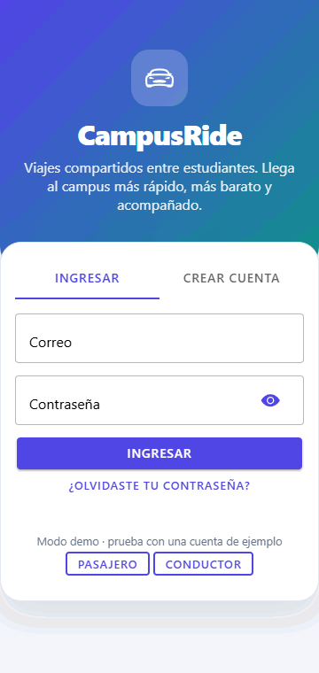
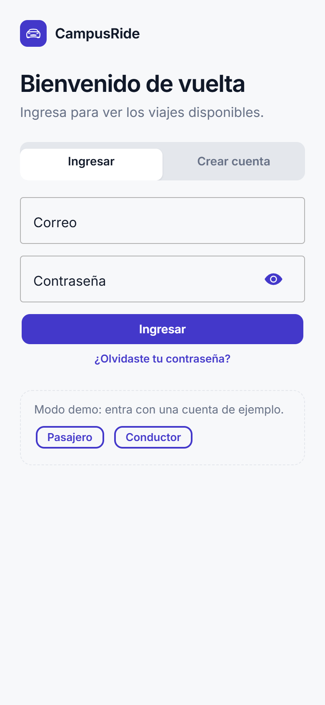
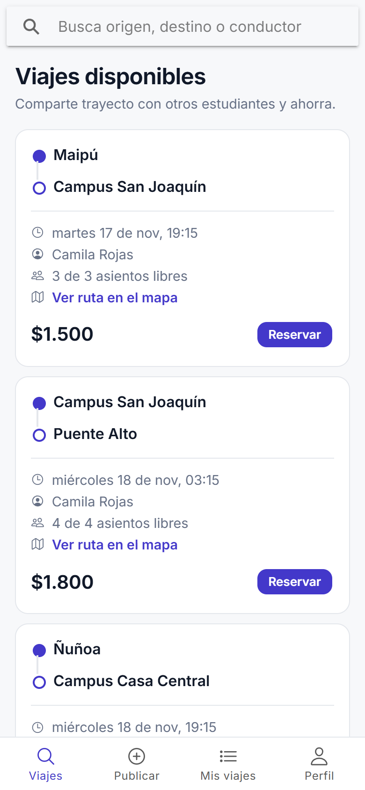
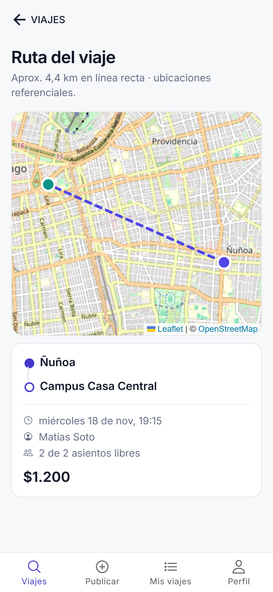
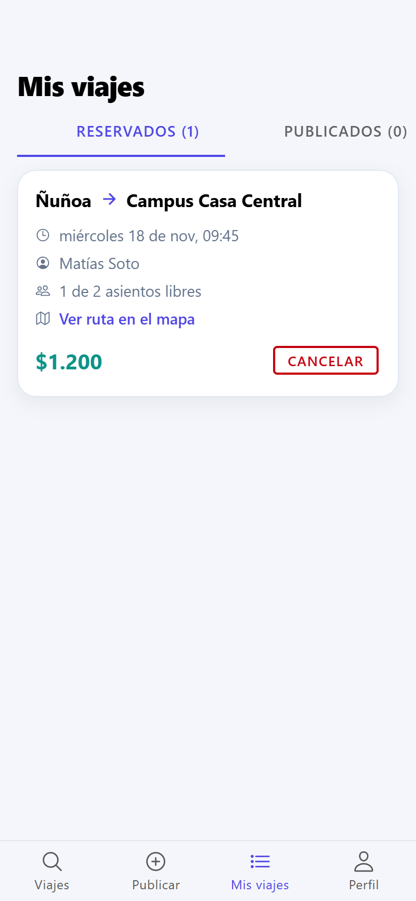
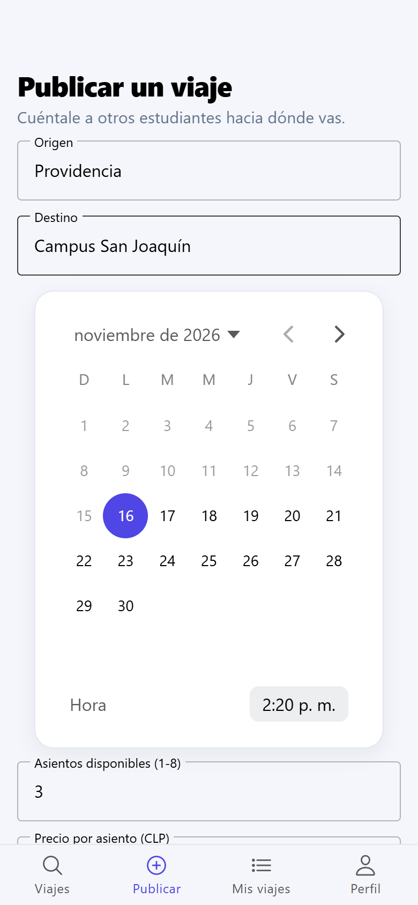

<div align="center">

# CampusRide

**Viajes compartidos entre estudiantes universitarios · Carpooling for university students**


[](https://github.com/nibrill/campusride/actions/workflows/ci.yml)


### [Probar la demo en vivo](https://nibrill.github.io/campusride/) · [Usar como plantilla](https://github.com/nibrill/campusride/generate)



[Español](#español) · [English](#english)

</div>

<p align="center">
  
  
  
  
  
</p>

---

## Español

CampusRide conecta a conductores y pasajeros que comparten trayecto hacia el campus. Los conductores publican viajes con origen, destino, horario, cupos y precio; los pasajeros buscan y reservan asiento en segundos.

> Proyecto universitario rediseñado desde cero (antes *TelLevoApp*): nueva arquitectura, interfaz moderna y backend intercambiable.

### Características

- Registro e inicio de sesión con validaciones y recuperación de contraseña.
- Roles **pasajero** y **conductor**, intercambiables desde el perfil.
- Publicación de viajes con selector de fecha/hora, cupos y precio en CLP.
- Búsqueda en vivo, reservas y cancelaciones con control de cupo (sin sobrerreservas).
- **Mapa de la ruta** de cada viaje con Leaflet y OpenStreetMap (sin API key), con distancia aproximada.
- Pestaña «Mis viajes» para ver reservas y viajes publicados.
- **PWA instalable**: se puede agregar a la pantalla de inicio y abre sin conexión.
- Modo claro/oscuro automático y diseño *mobile-first*.
- **Modo demo** sin configuración: los datos viven en el navegador. Con credenciales, usa **Firebase Auth + Firestore**.

### Arquitectura

```
src/app
├── core/            # Modelos, servicios, guards y backends
│   ├── backend.ts           # Contrato abstracto
│   ├── local.backend.ts     # Modo demo (localStorage)
│   └── firebase.backend.ts  # Firebase Auth + Firestore (carga perezosa)
└── pages/           # login · tabs · trips · publish · mine · profile
```

Interfaz con tipografía Inter empaquetada, tema claro/oscuro y una sola tinta de marca. Angular 22 con componentes *standalone*, *signals*, `OnPush`, control de flujo `@if/@for`, rutas con *lazy loading* y TypeScript estricto. El SDK de Firebase solo se descarga si lo configuras.

### Inicio rápido

```bash
git clone https://github.com/nibrill/campusride.git
cd campusride
npm install
npm start
```

Abre `http://localhost:4200` y usa las cuentas de ejemplo (`pasajero@demo.cl` / `conductor@demo.cl`, contraseña `demo1234`).

### Usar Firebase (opcional)

1. Crea un proyecto en [Firebase Console](https://console.firebase.google.com), activa **Authentication (correo/contraseña)** y **Firestore**.
2. Completa `firebase` en `src/environments/environment.ts` siguiendo `environment.example.ts`.
3. Publica las reglas de seguridad incluidas:

```bash
npx firebase-tools deploy --only firestore:rules
```

> Las claves web de Firebase no son secretos, pero no las compartas con reglas abiertas. Las reglas de este repo restringen cada operación al usuario autenticado.

### App móvil (Android / iOS)

```bash
npm run build
npx cap add android
npx cap sync && npx cap open android
```

### Úsalo como base para tu proyecto

Este repositorio es una **plantilla**: pulsa [**Use this template**](https://github.com/nibrill/campusride/generate) para crear tu propia copia y luego:

1. **Renombra la app:** `name` en `package.json`, `appId` y `appName` en `capacitor.config.ts`, y el `<title>` de `src/index.html`.
2. **Cambia la identidad visual:** colores y gradiente en `src/theme/variables.scss` (variables `--ion-color-*` y `--cr-*`) e ícono en `src/assets/icon/favicon.svg`.
3. **Adapta el modelo de datos:** las entidades están en `src/app/core/models.ts`.
4. **Conecta tu backend:** toda la app habla con la clase abstracta `Backend` (`src/app/core/backend.ts`). Crea tu implementación (REST, Supabase, etc.) y regístrala en `src/main.ts`; no hay que tocar las pantallas.
5. **Quita los datos de ejemplo:** las cuentas demo y los viajes de muestra se crean en `seed()` dentro de `src/app/core/local.backend.ts`.

Las contribuciones son bienvenidas: revisa [CONTRIBUTING.md](CONTRIBUTING.md). La arquitectura está explicada en [docs/ARCHITECTURE.md](docs/ARCHITECTURE.md) y el historial de versiones en el [CHANGELOG](CHANGELOG.md).

### Scripts

| Comando | Descripción |
| --- | --- |
| `npm start` | Servidor de desarrollo |
| `npm run build` | Compilación de producción |
| `npm test` | Pruebas unitarias (Vitest) |
| `npm run lint` | ESLint |
| `npm run test:e2e` | Pruebas end-to-end con Playwright (el servidor de desarrollo se levanta solo) |

### Próximos pasos

Geocodificación de direcciones exactas (hoy el mapa reconoce comunas y campus de Santiago definidos en `src/app/core/places.ts`), notificaciones push, calificaciones de conductores y chat entre pasajeros.

---

## English

CampusRide connects drivers and riders who share a commute to campus. Drivers publish trips (origin, destination, time, seats, price); riders search and book a seat in seconds.

> A university project rebuilt from scratch (formerly *TelLevoApp*) with a clean architecture, a modern UI and a swappable backend.

### Features

- Sign up / sign in with validation and password reset.
- **Passenger** and **driver** roles, switchable from the profile.
- Trip publishing with date/time picker, seat count and price (CLP).
- Live search, bookings and cancellations with seat-capacity checks.
- **Route map** for every trip (Leaflet + OpenStreetMap, no API key).
- "My trips" tab for bookings and published trips.
- **Installable PWA** with offline support.
- Automatic light/dark theme, mobile-first design.
- **Zero-config demo mode** (data stored in the browser); plug in credentials to use **Firebase Auth + Firestore**.

### Quick start

```bash
git clone https://github.com/nibrill/campusride.git
cd campusride
npm install
npm start
```

Sign in with the demo accounts (`pasajero@demo.cl` / `conductor@demo.cl`, password `demo1234`).

### Firebase (optional)

Fill in the `firebase` block in `src/environments/environment.ts` (see `environment.example.ts`) and deploy the included Firestore rules with `npx firebase-tools deploy --only firestore:rules`.

### Use it as a starter

Click [**Use this template**](https://github.com/nibrill/campusride/generate), then rename the app (`package.json`, `capacitor.config.ts`), restyle it in `src/theme/variables.scss`, and plug in your own backend by implementing the abstract `Backend` class (`src/app/core/backend.ts`) and registering it in `src/main.ts`. Try the [live demo](https://nibrill.github.io/campusride/) first.

### License

[MIT](LICENSE) © Nicolás Brill
