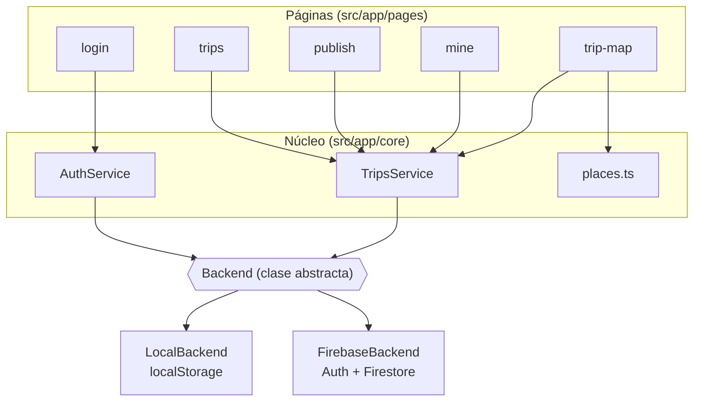

# Arquitectura de CampusRide

## Capas

Las páginas nunca hablan con Firebase ni con `localStorage`: solo con servicios y con la clase abstracta `Backend`. Por eso se puede cambiar el almacenamiento sin tocar la interfaz.

## Decisiones de diseño

### 1. Backend intercambiable
Toda la persistencia pasa por la clase abstracta `Backend`. `src/main.ts` elige `FirebaseBackend` si hay credenciales en `environment.ts` y `LocalBackend` en caso contrario.

- **Por qué:** cualquiera puede probar la app sin crear un proyecto de Firebase, y quien la use como plantilla puede conectar su propia API sin tocar las pantallas.
- **Costo:** cada operación nueva se implementa dos veces (local y Firebase).

### 2. SDK de Firebase con carga perezosa
`FirebaseBackend` importa el SDK con `import()` dinámico, así que el modo demo no descarga Firebase.

### 3. Mapa sin geocodificación externa
`src/app/core/places.ts` contiene comunas y campus de Santiago con coordenadas aproximadas. No requiere API key ni envía direcciones a terceros.

- **Limitación:** solo se dibuja la ruta si origen y destino coinciden con un lugar conocido. La ruta es una línea recta, no una ruta por calles.

### 4. Estado con signals
Los servicios exponen `signal`s de solo lectura y los componentes usan `OnPush`, sin necesidad de una librería de estado.

## Pruebas

- **Unitarias** (`npm test`, Vitest): lógica del backend local y de `places.ts`.
- **End-to-end** (`npm run test:e2e`, Playwright): flujos completos sobre el modo demo.

## Despliegue

- **CI** (`.github/workflows/ci.yml`): lint, tests, build y e2e en cada push y pull request.
- **Demo** (`.github/workflows/pages.yml`): compila y publica en GitHub Pages desde `main`. Incluye un `404.html` copiado de `index.html` para que las rutas de la SPA funcionen al recargar.
- **CodeQL** y **Dependabot** vigilan la seguridad y las dependencias.
